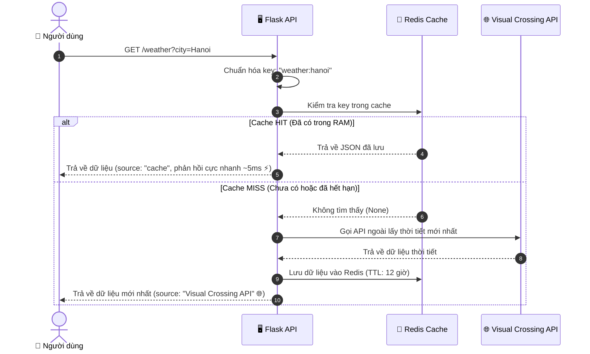

# 🌦️ ([Weather API Wrapper](https://github.com/kendunothing/WeatherAPITest))
Một RESTful API được xây dựng bằng **Python (Flask)** đóng vai trò trung gian (wrapper) lấy dữ liệu thời tiết từ dịch vụ bên thứ ba ([Visual Crossing API](https://www.visualcrossing.com/weather-api)), kết hợp cơ chế lưu trữ đệm **Redis Cache (Cache-Aside Pattern)** và kiểm soát tần suất truy cập **Rate Limiting**.

---

## 🚀 Luồng Hoạt Động (Architecture)



---

## ✨ Tính Năng Nổi Bật

- **Tích hợp 3rd-party API:** Kết nối và trích xuất dữ liệu thời tiết thời gian thực từ Visual Crossing Weather API.
- **In-memory Caching (Redis):** Giảm tải số lần gọi đến API ngoài, tiết kiệm hạn ngạch (quota) và tăng tốc độ phản hồi từ hàng trăm mili-giây xuống chỉ còn vài mili-giây.
- **Tự động dọn dẹp Cache (TTL):** Thiết lập thời gian sống cho dữ liệu trong cache (`EX = 12 hours`), đảm bảo dữ liệu không bị lỗi thời.
- **Rate Limiting:** Sử dụng `flask-limiter` với Redis backend để chống spam và tấn công DDoS (tối đa 5 lượt gọi/phút cho endpoint thời tiết).
- **Quản lý biến môi trường an toàn:** Tách biệt API key và cấu hình nhạy cảm thông qua file `.env`, tránh lộ mã bí mật khi chia sẻ mã nguồn.
- **Cấu trúc phân lớp (Clean Modular Architecture):** Tách biệt rõ ràng các tầng cấu hình (`config`), tầng dữ liệu (`service`), và tầng điều phối (`router`).

---

## 📁 Cấu Trúc Dự Án

```text
weatherAPIwrapper/
├── config.py           # ⚙️ Quản lý cấu hình & nạp biến môi trường từ .env
├── cache_service.py    # 💾 Module giao tiếp với Redis (đọc, ghi, kiểm tra kết nối)
├── weather_service.py  # 🌐 Module gọi API ngoài và chuẩn hóa dữ liệu thời tiết
├── app.py              # 🚀 Điểm khởi chạy chính: Điều phối request, routing, rate limit
├── requirements.txt    # 📦 Danh sách các thư viện Python cần cài đặt
├── .env.example        # 📄 File mẫu hướng dẫn thiết lập biến môi trường
├── .env                # 🔒 Chứa API key và thông tin cấu hình thực tế (được .gitignore bảo vệ)
└── README.md           # 📖 Tài liệu hướng dẫn dự án
```

---

## 🛠️ Yêu Cầu Cài Đặt

1. **Python:** Phiên bản 3.9 trở lên
2. **Redis Server:** Đã cài đặt và đang chạy trên máy (mặc định cổng `6379`)

---

## ⚡ Hướng Dẫn Cài Đặt & Khởi Chạy

### 1. Mở thư mục dự án và tạo môi trường ảo

```bash
cd weatherAPIwrapper
python3 -m venv venv
source venv/bin/activate
```

### 2. Cài đặt các thư viện cần thiết

```bash
pip install -r requirements.txt
```

### 3. Cấu hình biến môi trường

Tạo file `.env` từ file mẫu:
```bash
cp .env.example .env
```

Mở file `.env` và điền API key Visual Crossing của bạn:
```ini
CW_API=dien_api_key_cua_ban_o_day
REDIS_HOST=localhost
REDIS_PORT=6379
CACHE_TTL=43200
APP_PORT=5002
```

*(Đăng ký lấy API key miễn phí tại [visualcrossing.com](https://www.visualcrossing.com/weather-api)).*

### 4. Khởi động Redis Server

Trên macOS (dùng Homebrew):
```bash
brew services start redis
# Kiểm tra:
redis-cli ping   # Trả về PONG là thành công
```

### 5. Khởi chạy ứng dụng Flask

```bash
python app.py
```

Ứng dụng sẽ chạy tại địa chỉ: `http://localhost:5002`

---

## 📚 Tài Liệu API (Endpoints)

### 1. Trang chủ
- **URL:** `/`
- **Method:** `GET`
- **Mô tả:** Trả về thông tin chào mừng và hướng dẫn các endpoint sẵn có.

### 2. Kiểm tra sức khỏe hệ thống (Health Check)
- **URL:** `/health`
- **Method:** `GET`
- **Mô tả:** Kiểm tra tình trạng kết nối tới Redis Server.
- **Ví dụ phản hồi:**
  ```json
  {
    "redis": "connected ✅",
    "status": "healthy"
  }
  ```

### 3. Lấy thông tin thời tiết
- **URL:** `/weather`
- **Method:** `GET`
- **Query Parameters:**
  - `city` *(bắt buộc)*: Tên thành phố cần tra cứu (ví dụ: `Hanoi`, `Paris`, `London`).
- **Giới hạn truy cập (Rate Limit):** Tối đa 5 requests / phút.

#### Ví dụ Request:
```bash
GET http://localhost:5002/weather?city=Hanoi
```

#### Ví dụ Phản hồi Thành Công (`200 OK`):
```json
{
  "city": "Hà Nội, Việt Nam",
  "temperature": 28.5,
  "feels_like": 31.2,
  "humidity": 78,
  "description": "Partially cloudy",
  "wind_speed": 14.8,
  "source": "Visual Crossing API (Fresh) 🌐"
}
```
*(Nếu gọi lại cùng một thành phố ngay sau đó, trường `"source"` sẽ chuyển thành `"cache (Redis) ⚡"`).*

---

## ⚠️ Bảng Mã Lỗi (Error Handling)

| Mã lỗi HTTP | Tình huống | Thông báo mẫu |
|:---:|---|---|
| **400 Bad Request** | Không truyền tham số `city` | `{"error": "Missing 'city' parameter"}` |
| **404 Not Found** | Không tìm thấy tên thành phố / Sai API key | `{"error": "Could not find weather data for 'xyz'"}` |
| **429 Too Many Requests** | Vượt quá giới hạn gọi API (5 lần/phút) | `429 Too Many Requests: 5 per 1 minute` |
| **503 Service Unavailable** | Mất kết nối internet hoặc API ngoài sập | `{"error": "Cannot connect to external weather service"}` |
| **504 Gateway Timeout** | API ngoài phản hồi quá chậm (> 10s) | `{"error": "Weather service is taking too long to respond"}` |

---

## 🧰 Công Nghệ Sử Dụng

- **Ngôn ngữ:** Python 3.9+
- **Web Framework:** Flask 3.x
- **Cache Engine:** Redis, `redis-py`
- **Rate Limiting:** `Flask-Limiter`
- **HTTP Client:** `requests`
- **Quản lý cấu hình:** `python-dotenv`

## Link project
- https://github.com/kendunothing/WeatherAPITest
- https://roadmap.sh/projects/weather-api-wrapper-service

